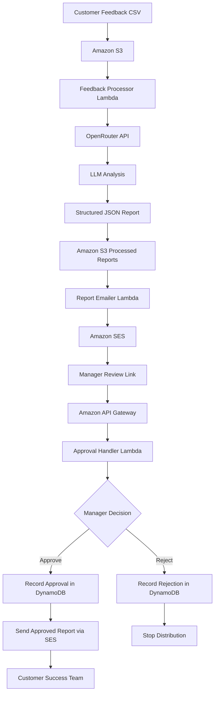

# aws-csat-feedback-ai-workflow
Turn customer feedback report ( i.e CSAT Salesforce ) into actionable insights with AI-powered analysis, human-in-the-loop approval, and automated report delivery.
# AI-Powered Customer Success Intelligence Agent

**Turn customer feedback into actionable insights with AI-powered analysis, human-in-the-loop approval, and automated report delivery.**

The Customer Success Intelligence Agent processes customer feedback, uses AI models through the OpenRouter API to identify sentiment and recurring themes, generates structured reports, and routes the results to a manager for review.

Reports are distributed to the designated team only after managerial approval.

This project combines LLM integration, event-driven automation, AWS serverless architecture, and human decision-making in a practical Customer Success workflow.

## The Problem

Customer Success and Support managers often review large volumes of customer feedback to understand dissatisfaction, identify recurring problems, and prioritize service improvements.

Manual analysis can be time-consuming, inconsistent, and difficult to scale.

This project demonstrates how an AI-powered workflow can help managers:

- Summarize customer sentiment and recurring feedback themes.
- Identify potential customer pain points and service-quality issues.
- Generate structured insights and suggested follow-up actions.
- Review AI-generated reports before they reach the team.
- Reduce repetitive analysis while retaining managerial control.

**The objective is to augment managerial judgment, not replace it.**

## Architecture



## End-to-End Workflow

### 1. Feedback ingestion

A CSV containing customer feedback is uploaded to Amazon S3, initiating the processing workflow.

### 2. AI-powered feedback analysis

AWS Lambda sends the feedback and analysis instructions to an LLM through the **OpenRouter API**.

The model can be prompted to identify:

- Customer sentiment.
- Recurring themes and complaints.
- Potential service-quality concerns.
- Suggested follow-up actions.

The model and output depend on the OpenRouter configuration and prompt used by the application.

### 3. Structured report generation

The processor converts the model's response into a structured JSON report and saves it to Amazon S3 for downstream processing.

### 4. Manager notification

A separate Lambda function uses Amazon SES to email the manager a review link.

### 5. Human-in-the-loop approval

The manager opens the review interface and explicitly approves or rejects the report. Amazon API Gateway routes the decision to the approval Lambda, while Amazon DynamoDB records the workflow state.

### 6. Controlled report distribution

- **Approved:** the report is retrieved from S3 and sent to the designated team through Amazon SES.
- **Rejected:** the workflow stops without sending the report to the team.

Conditional database updates help protect against duplicate or conflicting decisions.

### 7. Business action

The Customer Success or Support team reviews the approved findings and determines which issues need investigation, escalation, or service improvement.

## Built for Customer Success and Support Managers

| Use case | Potential business value |
|---|---|
| Sentiment overview | Understand positive, negative, and mixed customer experiences |
| Complaint identification | Discover recurring issues across feedback |
| Service-quality monitoring | Surface potential delays and repeat problems |
| Action prioritization | Identify themes that may deserve further investigation |
| Customer experience improvement | Generate follow-up suggestions for manager review |
| Controlled reporting | Ensure a human reviews AI-generated reports before distribution |

These are intended use cases; the reliability of the insights depends on the quality of the input, model behavior, and prompt design.

## Technology Stack

| Technology | Purpose |
|---|---|
| OpenRouter API | Access LLMs for customer feedback analysis |
| AWS Lambda | Serverless processing, notification, and approval logic |
| Amazon S3 | Store input CSV files and processed JSON reports |
| Amazon API Gateway | Expose manager review and decision endpoints |
| Amazon DynamoDB | Store approval state and token metadata |
| Amazon SES | Send manager notifications and approved reports |
| AWS IAM | Control access between AWS services |
| Amazon CloudWatch | Logs and troubleshooting |

## Human-in-the-Loop Design

AI-generated analysis may be incomplete or incorrect. This workflow includes a manager decision gate before reports are shared with the team.

The manager can:

- **Review** the AI-generated report.
- **Approve** distribution to the designated team.
- **Reject** the report and stop distribution.
- **Track** the decision and delivery status through the workflow's DynamoDB records.

This approach keeps a human accountable for the distribution decision instead of allowing AI output to flow directly to the team without review.

The approval gate does not guarantee that the analysis is correct; important findings should be checked against the original feedback.

## Example Input

```csv id="a31k5x"
feedback_id,feedback
F001,"Support resolved my issue quickly and professionally."
F002,"The application was slow and my support request took too long."
F003,"The agent was helpful, but the same issue returned."
F004,"The onboarding process was clear and easy to follow."
```

All example feedback is synthetic.

## Example AI-Generated Report

An illustrative output format:

```json id="a31k5x"
{
  "sentiment_summary": {
    "positive": 2,
    "negative": 1,
    "mixed": 1
  },
  "key_themes": [
    "Support responsiveness",
    "Application performance",
    "Recurring issues",
    "Onboarding experience"
  ],
  "recommended_actions": [
    "Investigate recurring customer issues",
    "Review application performance complaints",
    "Continue monitoring support responsiveness"
  ]
}
```

This is a sample schema, not a claim about a particular model run.

## Engineering and Security Considerations

The project demonstrates:

- Separation of processing, notification, and approval responsibilities.
- API-based integration with an external LLM provider.
- Event-driven processing and report storage.
- Expiring approval tokens and token-hash lookup.
- Conditional DynamoDB state transitions.
- IAM permissions for AWS service interactions.
- CloudWatch logging for troubleshooting.

Before production use, additional considerations include API-key management through AWS Secrets Manager or an equivalent secure mechanism, API usage limits and cost controls, retries and recovery, input validation, protection of sensitive customer data, and validation of model output.

## Repository Structure

```text id="a31k5x"
aws-csat-feedback-ai-workflow/
├── README.md
├── architecture/
│   └── architecture.png
├── Screenshot/
│   └── images
├── sample-data/
│   └── sample_feedback.csv
├── lambda/
│   ├── feedback_processor/
│   ├── report_emailer/
│   └── approval_handler/
└── .gitignore
```

Adjust this structure to reflect the actual files in your repository.

## Future Enhancements

- **Trend analysis:** compare customer sentiment across reporting periods.
- **Evidence-backed insights:** link conclusions to snippets from the source feedback.
- **Priority scoring:** highlight potentially urgent customer issues.
- **Automated tests:** validate approvals, rejections, expired tokens, and delivery failures.
- **Infrastructure as Code:** provision resources using Terraform.
- **Observability:** add CloudWatch metrics, alarms, and operational dashboards.
- **CI/CD:** validate and deploy code through GitHub Actions.
- **Model evaluation:** compare LLM outputs for consistency, accuracy, and cost.

These are planned extensions, not implemented features unless added to the codebase.

## Project Summary

This project combines LLM-powered analysis through OpenRouter with AWS serverless services and a human approval workflow to demonstrate a practical AI-enabled Customer Success use case.

**Key concepts:** LLM integration · AI agent workflow · Human-in-the-loop approval · AWS serverless · Event-driven automation · Secure API integration · Operational troubleshooting

---

*Portfolio project for learning and demonstration. Use synthetic data in public examples, and review privacy, security, reliability, and cost controls before production deployment.*
